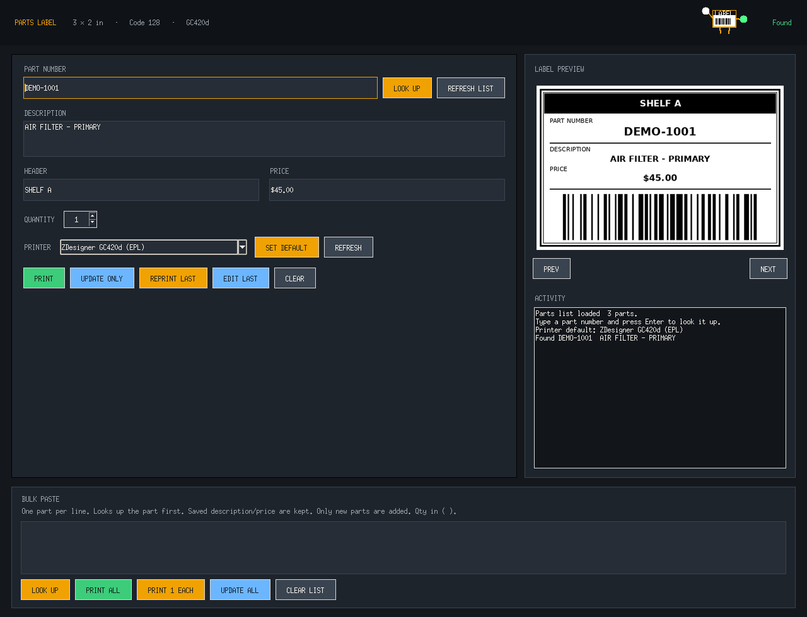
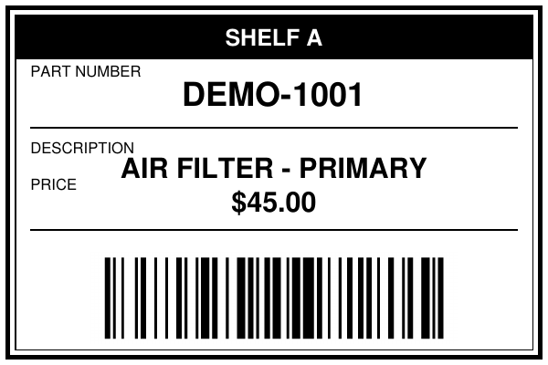

# Parts Label

Shop-floor program for the parts room. Look up a part number, check the description and price, and print a **3 × 2 inch** label with a **Code 128** barcode on a **Zebra GC420d**.





The pictures use fake demo parts (`DEMO-1001` and similar). The real parts list, with shop prices, is **not** in this repository.

## What it does

- Looks up a part number in a CSV parts list and fills in the description, header, and price.
- Lets you edit those fields before printing.
- Shows a preview of the 3×2 label.
- Prints one or more copies to the Zebra, or updates the parts list without printing.
- Pastes a whole list (bulk paste) and looks up, prints, or updates every line.
- Reprints or reloads the last label.
- Reloads the parts list by itself when the CSV file changes (about every 3 seconds). **REFRESH LIST** reloads it immediately.
- Remembers which parts-list file and which printer you picked. Those stay put across installs, updates, and uninstalls.

The version number is in one file, [`version.py`](version.py), and it shows in the window title and under **Help → About Parts Label**.

## Install on Windows

### Installer (the usual way)

1. Open the [Releases](https://github.com/losava/parts-label-maker/releases) page.
2. Download **`PartsLabel-Setup-<version>.exe`** from the newest release (for example `PartsLabel-Setup-1.0.0.exe`).
3. Run it. It installs for the current Windows user into `%LOCALAPPDATA%\Parts Label`. It does not ask for an administrator password.
4. It adds a **Parts Label** shortcut to the Start Menu and the desktop, and it adds an uninstaller (Windows Settings → Apps → Parts Label).
5. On the first launch, point it at the existing parts list. See [Switching from the LABEL MAKER folder](#switching-from-the-label-maker-folder) below.

### Run from the scripts

Use this when you want to keep launching it from the `LABEL MAKER` folder.

1. Install Python 3 from [python.org](https://www.python.org/downloads/) and check **Add python.exe to PATH**.
2. Put these files in the same folder: `parts_label_app.py`, `make_parts_label.py`, `version.py`, `updater.py`, and `MakePartsLabel.bat`.
3. Double-click **`MakePartsLabel.bat`**. It installs the Python packages the first time, then opens the window.
4. `MakePartsLabel.vbs` starts that same bat file. `MakePartsLabel.ps1` runs the console generator (`make_parts_label.py`) instead of the window.

The console generator is still there:

```bat
python make_parts_label.py
python make_parts_label.py "DEMO-1001" "AIR FILTER - PRIMARY" --header "SHELF A"
python make_parts_label.py --version
```

## Install on Linux

Packages are attached to the same [Release](https://github.com/losava/parts-label-maker/releases). They are built on Ubuntu 22.04 and run on Ubuntu 22.04 and newer.

Printing goes through CUPS (`lp -o raw`). If CUPS is not installed, or no printer is set up, the window still opens and lookup still works. Print reports the problem in the activity log and continues.

### AppImage

Download `PartsLabel-<version>-x86_64.AppImage`, mark it executable, and run it:

```bash
chmod +x PartsLabel-1.0.0-x86_64.AppImage
./PartsLabel-1.0.0-x86_64.AppImage
```

### Debian package

```bash
sudo apt install ./parts-label-maker_1.0.0_amd64.deb
parts-label
```

`cups-client` is recommended so the `lp` command is available. Removing the package leaves your parts-list setting in place.

### Tarball (per user, no administrator)

```bash
tar -xzf PartsLabel-1.0.0-linux-x86_64.tar.gz
cd PartsLabel-1.0.0-linux-x86_64
./install.sh
```

That installs a menu entry and `~/.local/bin/parts-label`. Log out and back in if the command is not found yet.

### Run from source

```bash
python3 -m pip install -r requirements.txt
python3 parts_label_app.py
```

On Linux, `python3-tk` (Tk) has to be installed for the window.

## The parts list

The app reads and writes a CSV file. It does not ship with the shop list. `parts_list_sample.csv` is demo data only, for screenshots and for trying the window. Choose the real file; do not replace the shop list with the sample.

**Columns**

| Column | What it is |
| --- | --- |
| `PartNo` | Part number. Lookup ignores extra spaces and spaces around dashes. |
| `Description` | Text under the part number on the label. |
| `Price` | Optional. `$45.00` or `45.00`. |
| `Header` | Optional black bar at the top of the label, such as a shelf. |

An older export that uses `PAR:PartNo` and `PAR:Description` still loads for lookup. Saving writes the four-column file above.

**Where the file lives**

The app uses whichever file you choose, and it remembers the full path.

- In the original `LABEL MAKER` folder, that file is `parts_list_clean.csv` sitting next to the scripts. Other shop tools edit that same file. Keep using it.
- **File → Choose Parts List…** points the app at that file (or any other CSV).
- The first time the installed app cannot find a list, it asks you to choose the existing file. **Create new empty list** is a separate button, and it asks again before it creates anything.
- If the remembered file is missing (drive unplugged, file moved), the app does not quietly switch to a different list.
- **File → Open Parts List Folder** opens the folder that contains the CSV.

When you run the scripts from the `LABEL MAKER` folder, a `parts_list_clean.csv` next to them is picked up and remembered automatically.

The window checks the file about every 3 seconds. If another tool saved it, the in-memory list refreshes. **REFRESH LIST** does the same thing on demand. While a print or update is running, the automatic refresh waits.

Generated PDF copies go in a `Parts List` folder next to the scripts. The installed Windows app writes those PDFs under the user data folder instead, so an uninstall does not delete them.

## Printer

The label stock is **3 × 2 inches**. The shop printer is a **Zebra GC420d** with the **ZDesigner** driver. The usual Windows printer name is `ZDesigner GC420d (EPL)`.

1. Install the ZDesigner driver and confirm a test label from Windows Settings.
2. In Parts Label, pick that printer in the **PRINTER** list.
3. Click **SET DEFAULT**. The choice is saved for the next launch.
4. **REFRESH** reloads the printer list.

The app sends the label as raw ZPL, which matches the printed layout. On Windows that goes through the ZDesigner driver (`win32print`). On Linux it goes to a CUPS queue:

```bash
lp -d GC420d -o raw
```

Add the printer in CUPS as a raw (passthrough) queue so the printer receives ZPL unchanged. Then pick that queue in the window and click **SET DEFAULT**. If `lp` is missing or the queue rejects the job, the activity log says so and the parts list is still updated when you asked for an update.

## Updates

Updates are optional. The app never downloads or installs one on its own.

- **UPDATES** in the header, or **Updates → Check for Updates**, asks GitHub whether [losava/parts-label-maker](https://github.com/losava/parts-label-maker) has a newer release.
- A few seconds after startup it can check in the background. Turn that off with **Updates → Check for Updates on Startup**. The choice is remembered.
- When a newer version exists, a window shows the release notes and three buttons:
  - **Download & install** — downloads the installer for this computer and opens it. You still click through that installer. Windows does not use a silent install. On Linux, a `.deb` opens in the software installer, and an AppImage is saved for you to start.
  - **Not now** — closes the notice.
  - **Skip this version** — stays quiet about this version at startup. Check for Updates still finds it if you ask.
- Offline, or if GitHub does not answer, the startup check does nothing. A manual check says it could not reach GitHub. Lookup and printing keep working.

Downloaded installers are stored in the user data folder under `updates`.

## Where your data lives

| | Windows | Linux |
| --- | --- | --- |
| Settings (parts-list path, printer, update choices) | `%APPDATA%\PartsLabel\settings.json` | `~/.local/share/parts-label-maker/settings.json` (`$XDG_DATA_HOME` when that is set) |
| Printer name, also written as a one-line file | `%APPDATA%\PartsLabel\printer_name.txt` | same folder, `printer_name.txt` |
| Parts list | The path you chose. For this shop, that is `parts_list_clean.csv` in the `LABEL MAKER` folder. | The path you chose |
| PDFs from the installed app | `%APPDATA%\PartsLabel\Parts List` | `~/.local/share/parts-label-maker/Parts List` |
| Program files | `%LOCALAPPDATA%\Parts Label` | `/usr/lib/parts-label`, `~/.local/lib/parts-label`, or the AppImage file |

**File → Open Settings Folder** opens the settings folder.

Uninstalling the program removes the program files and the shortcuts. It leaves the settings folder and the parts CSV alone. Running from the scripts still also writes `printer_name.txt` next to the scripts, so the old folder keeps that file too.

## Switching from the LABEL MAKER folder

The shop PC already has `parts_list_clean.csv` next to the scripts, in a folder named `LABEL MAKER`. Other tools edit that file there. Do this once:

1. Install Parts Label from the Release (the Windows setup exe). Leave the `LABEL MAKER` folder where it is.
2. Start **Parts Label** from the desktop or Start Menu.
3. When it asks where the parts list is, click **Choose existing file** and select the `parts_list_clean.csv` inside `LABEL MAKER`. Do not click **Create new empty list**.
4. The activity log should show that path. Look up a part you know and confirm the description and price are the real ones.
5. Pick **ZDesigner GC420d (EPL)** (or whatever the driver is named) and click **SET DEFAULT**.
6. Print one test label.

After that, the installed app and the other shop tools share the same CSV. You can keep the old scripts until you are happy with the shortcut. Updating or uninstalling Parts Label does not move or delete that CSV.

If you already ran this version of the scripts once from the `LABEL MAKER` folder, the path is remembered in `%APPDATA%\PartsLabel` and the installed app uses it without asking.

## Cutting a release

The version in `version.py` is the version the app shows and the version the installers are named with.

1. Change `__version__` in `version.py`.
2. Commit and push to `main`.
3. Tag that commit and push the tag:

```bash
git tag -a v1.0.0 -m "Parts Label 1.0.0"
git push origin v1.0.0
```

Pushing a `v*` tag runs GitHub Actions (`.github/workflows/release.yml`). The workflow tests the CSV logic, builds the Windows installer and the Linux packages, and attaches them to a GitHub Release:

- `PartsLabel-Setup-<version>.exe`
- `PartsLabel-<version>-x86_64.AppImage`
- `parts-label-maker_<version>_amd64.deb`
- `PartsLabel-<version>-linux-x86_64.tar.gz`

Pull requests and pushes to `main` run the same tests and package builds (`.github/workflows/ci.yml`) without publishing a release.

To rebuild without a new tag, open the **Release** workflow in the Actions tab and run it with **Run workflow**. That rebuilds the artifacts. Publishing them to a Release happens when the run is for a `v*` tag.

## Tests

No printer is required.

```bash
python -m pip install -r requirements.txt pytest
python -m py_compile parts_label_app.py make_parts_label.py version.py updater.py
python -m pytest -q
```

Linux packages can be built on a machine with the dev requirements:

```bash
python -m pip install -r requirements-dev.txt
bash packaging/linux/build-linux.sh
```

The Windows installer is built with `packaging/windows/build-windows.ps1` (PyInstaller and [Inno Setup 6](https://jrsoftware.org/isdl.php)).

## License

[MIT](LICENSE).
